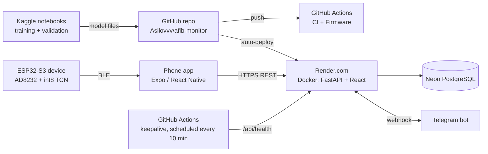

# Deployment and infrastructure

How each part of AFib Monitor is built, tested and run. This is the "Facilities" and deployment description for the
thesis (sections 3 and 4).

## Server
| Part | How it runs | Source |
|---|---|---|
| API + doctor portal | One Docker container (`Dockerfile`): Node 22 builds the React portal, then Python 3.12 runs FastAPI with uvicorn and serves the portal | `Dockerfile`, `render.yaml` |
| Hosting | Render.com web service, free plan, created from the Blueprint in `render.yaml`; every push to `main` redeploys | `render.yaml` |
| Database | PostgreSQL on Neon through the `DATABASE_URL` variable. Without it the server falls back to SQLite, which is enough for the demo | `backend/app/db.py` |
| Secrets | `JWT_SECRET` is generated by Render; `DATABASE_URL` and `TELEGRAM_BOT_TOKEN` are set by hand in Render → Environment and never committed | `render.yaml`, README §3 |
| Telegram | The server registers its webhook at `/api/telegram/webhook` on start-up; locally it uses long polling | README §3 |
| Staying awake | Render's free plan sleeps after 15 minutes without traffic, so `keepalive.yml` is scheduled to call `/api/health` every 10 minutes; GitHub actually ran it about every 4 hours in October 2026 (`docs/engineering/TEST_REPORT.md` §8), so cold starts happen | `.github/workflows/keepalive.yml` |
| Health | `/api/health` (fast) and `/api/health?deep=1` (database, mode, version) | `backend/app/main.py` |

## Continuous integration (every push)
| Workflow | Jobs |
|---|---|
| **CI** (`ci.yml`) | backend tests on SQLite; the same tests on PostgreSQL 16; web portal build; mobile app TypeScript check |
| **Firmware** (`firmware.yml`) | Python vs C++ parity for the 30-s check (40 strips); PVC model parity, bit for bit (910 beats); device header generated from the committed model; patch schematic rules check; firmware pins = schematic pins = footprint pads; firmware build for the M5Stack prototype and for patch v1 |

## Mobile app
Expo / React Native, `mobile/`. Bluetooth needs a development build (`npx expo run:android` / `run:ios`, or cloud builds with
`eas build` using the profiles in `mobile/eas.json`). The app works offline: readings and ECG strips queue on the phone and
reminders are local notifications.

## Firmware
Arduino (esp32 core 3.x), `firmware/AFibMonitor/`. Build for the prototype with board "M5CoreS3", or for our patch with
"ESP32S3 Dev Module" and `-DBOARD_PATCH_V1` (pins in `board.h`). CI uploads both `.bin` files as build artifacts.
Bench test steps: `firmware/BENCH_TEST.md`.

## Machine learning
Training and every validation run on Kaggle (free CPU and GPU). The rules are committed to `ml/` before each run, and the
notebook prints a hash of its code so that the log proves which commit ran. Results are recorded in `ml/*.md`. Model files
come back into the repository (`firmware/AFibMonitor/afib_model_data.h`, `backend/app/pvc_model.json`).

## Hardware
`hardware/patch_v1/design.py` writes the netlist, the JLCPCB BOM and the KiCad netlist (`hardware/patch_v1/kicad/`).
Layout, routing and the IEC 60601-1 safety review are not done yet; they need an electronics engineer.

## Screenshots
`docs/screenshots/web/` (doctor portal) and `docs/screenshots/mobile/` (patient app, light and dark themes). Newest:
`checkplan-desk.png` (scheduled 30-s checks on the patient page) and `report-v21-desk.png` (one-page A4 report with the
check and PVC lines).
