# Architecture and detailed design

FEI Full-Stack guideline, Appendix 1 §5 (architecture, technology selection, data and interfaces, user interface).
Index: [README.md](README.md). The diagrams are Mermaid and render on GitHub; each one names the files it describes, so
design and code can be compared.

## 1. Architectural idea

**Edge inference, thin cloud.** The rhythm is analysed on the sensor itself (ESP32-S3). The phone and the server do not
run the neural network: they show, store, combine and deliver what the device decided, and they run the *same*
30-second check rule as the chip so that a strip gives one verdict everywhere. Three reasons, all from the
requirements:

1. **Offline first** (FR-09): the check must work in a village with no mobile internet; the device needs neither.
2. **One verdict** (NFR-02): the 30-s rule is small and deterministic, so it is implemented three times (C++, TypeScript,
   Python) and kept identical by tests on shared strips instead of trusting one tier.
3. **Free tier** (constraint): a server on 0.1 CPU cannot run inference for many streams; it only stores readings that
   arrive every 20 s.

The price is three implementations of one rule; the parity tests in CI are what make that acceptable.

## 2. System context (C4 level 1)

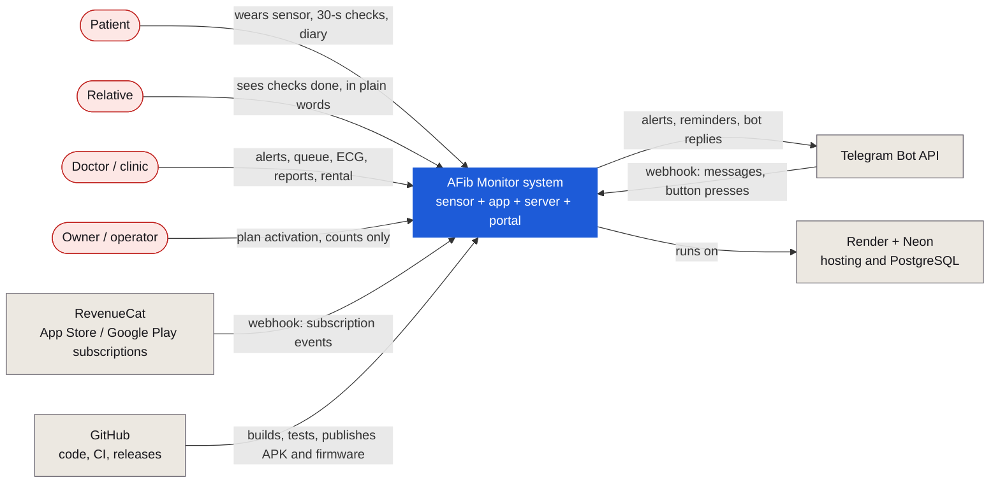

## 3. Containers (C4 level 2) and the component codes used in the traceability table

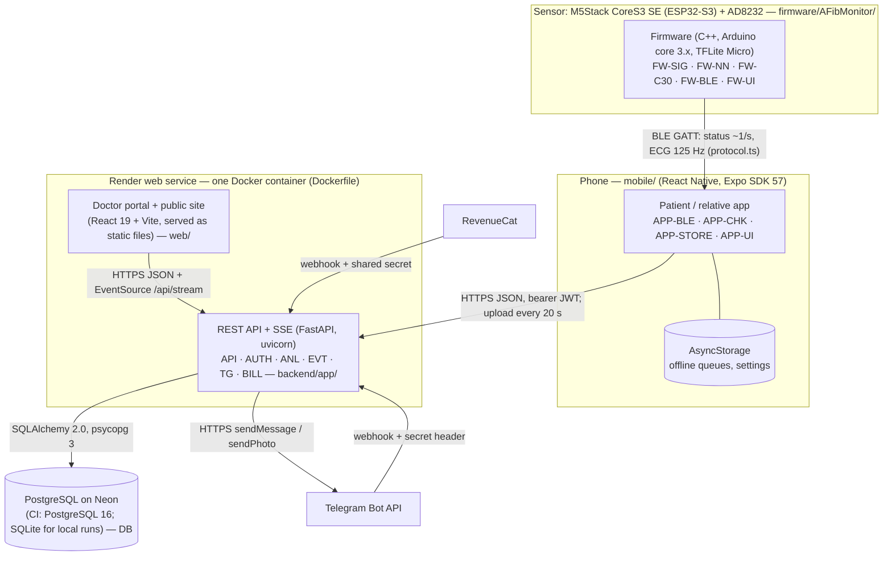

| Code | Component | Where | Responsibility |
|---|---|---|---|
| FW-SIG | sampling, filter, R detector, signal guards | `afib_main.cpp` (`adcTask`), `live_path.h`, `clip.h`, `live_gate.h` | 250 Hz ADC on core 0, band-pass + decimation to 125 Hz, envelope R detector, saturation / flat / lead-off guards |
| FW-NN | RR-interval TCN, int8 | `afib_main.cpp` (`setupModel`, `runModel`), `afib_model_data.h` | 32 RR → probability every 4 beats, TFLite Micro, 9,920 B arena |
| FW-C30 | 30-second check | `check30.h` | two R detectors, bSQI ≥ 0.8, SQI ≥ 0.4, ≥ 16 beats, irregularity > 0.10 |
| FW-BLE | GATT server | `afib_main.cpp` (`setupBle`, `bleSend`) | status and ECG notifications |
| FW-UI | screen and touch | `afib_main.cpp` (`drawStatus`, `drawCheck`) | live strip, wellness wording, two-check confirmation |
| APP-BLE | BLE client and decoding | `mobile/src/ble.ts`, `protocol.ts`, `ecgbus.ts` | scan, connect, decode, simulator in demo mode |
| APP-CHK | 30-second check on the phone | `mobile/src/rr.ts`, `screens/CheckSheet.tsx` | same rule as FW-C30 and ANL |
| APP-STORE | state, offline queues, sync | `mobile/src/store.tsx`, `api.ts` | readings ≤ 20,000, ECG ≤ 20, symptoms; sync every 20 s |
| APP-UI | screens | `mobile/src/screens/*` | Monitor, History, Diary, Profile, Family, sheets |
| API | HTTP endpoints and business rules | `backend/app/main.py` | 77 routes, validation, roles, modes, plans |
| AUTH | passwords and tokens | `backend/app/auth.py` | bcrypt, HS256 JWT, role guard |
| ANL | analytics | `analytics.py`, `ecgtools.py`, `ectopy.py`, `risk.py` | episodes, burden, HR events, 30-s check, Poincaré, PVC estimate, CHA₂DS₂-VASc |
| EVT | live events | `events.py` | in-process broker → SSE to doctors |
| TG | Telegram | `telegram.py`, `bot_texts.py` | alerts with ECG image, patient bot, reminders |
| BILL | plans | `plans.py` + webhook in `main.py` | limits, trial, invoice, RevenueCat |
| DB | schema | `models.py`, `db.py` | 28 tables, constraints, indexes |
| WEB | doctor portal and public pages | `web/src/pages/*` | 14 page modules (incl. the shell), live alerts, reports |
| CI | pipelines | `.github/workflows/*.yml` | tests, parity, builds, releases |

## 4. Components

### 4.1 Firmware

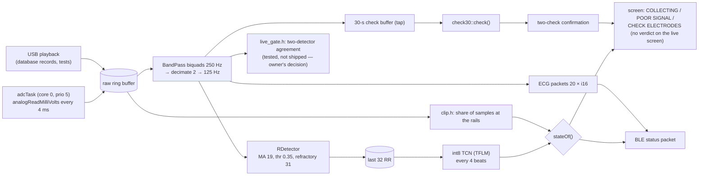

The main loop on core 1 does filtering, detection, inference, drawing and BLE; sampling has its own task so drawing
cannot delay it. The live screen shows no rhythm verdict to the person (round 4, wellness wording); the model's score is
shown only during database playback over USB and goes to the research mode of the app.

### 4.2 Server

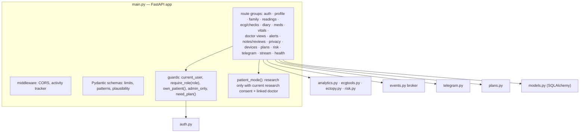

## 5. Sequences

### 5.1 A 30-second check, end to end (FR-03, FR-08, FR-19)

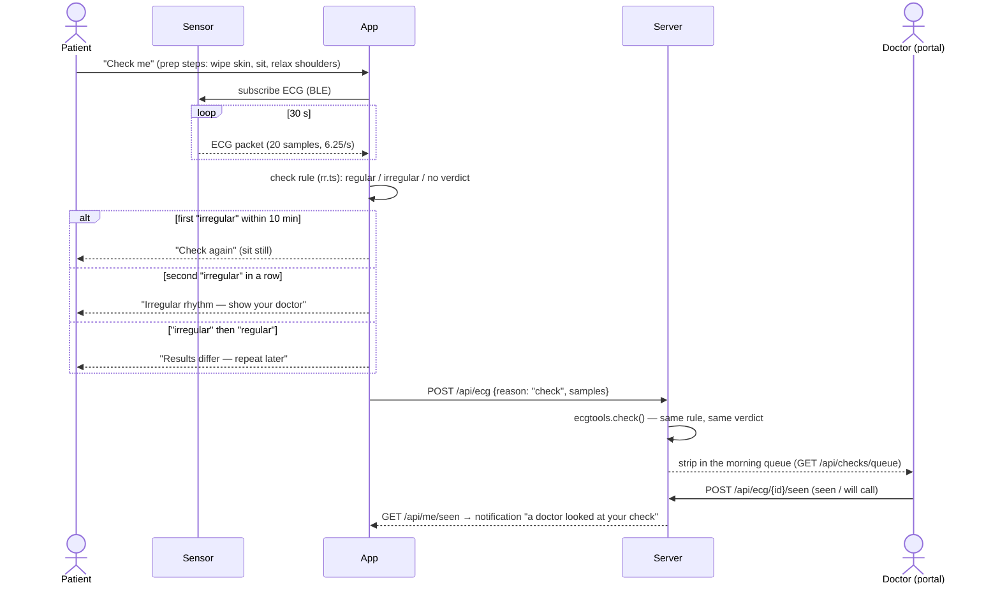

The device runs the same rule on its own screen (tap on the status bar) without a phone.

### 5.2 AF onset in research mode (FR-15, FR-17, FR-24)

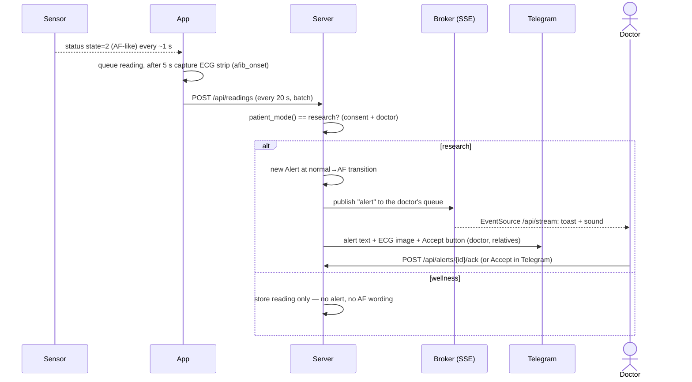

### 5.3 Sign-up and linking to a doctor (FR-06)

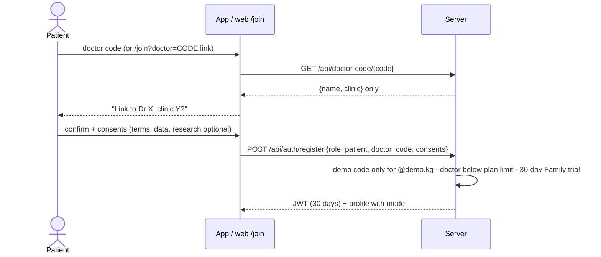

### 5.4 Offline queue and sync (FR-09)

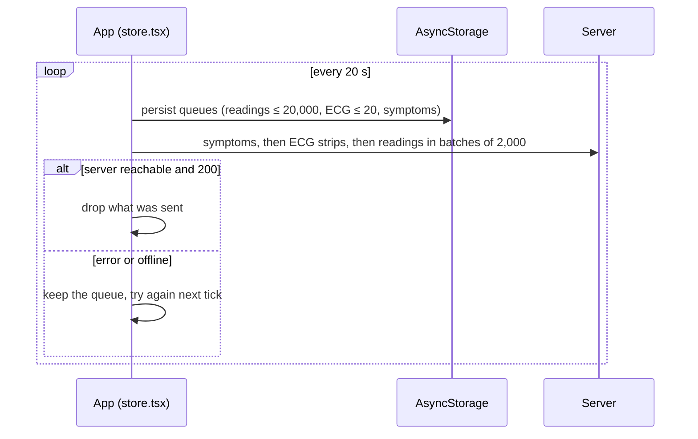

## 6. Data flow and trust boundaries

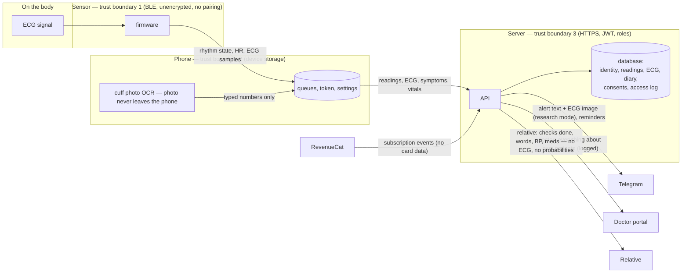

Personal data classes and their rules are in [SECURITY_PRIVACY.md §2](SECURITY_PRIVACY.md#2-privacy).

## 7. States

### 7.1 Device rhythm state (BLE status byte, `stateOf()`)

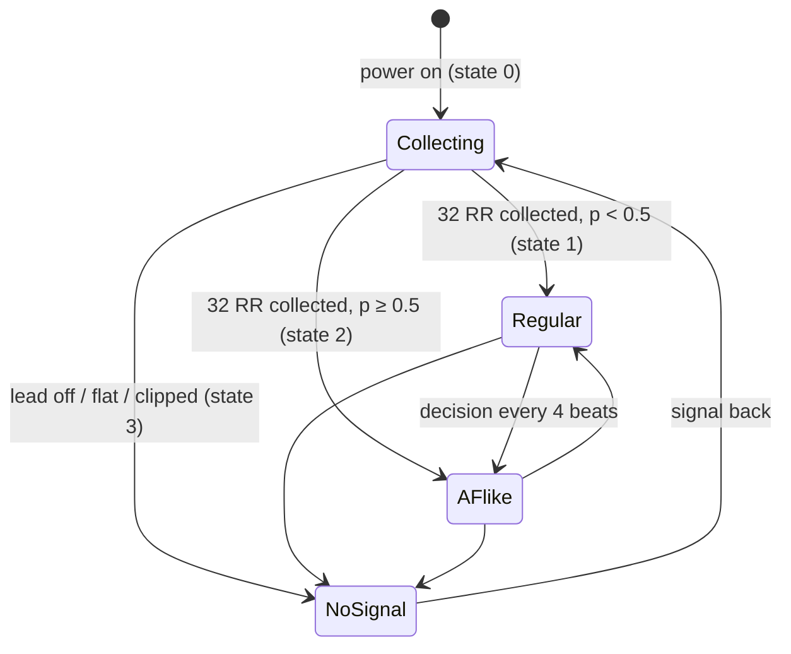

States 1 and 2 are shown as words only in research mode; in wellness mode the app shows the 30-s check instead.

### 7.2 Two-check confirmation (`finishCheck()` on the device, `CheckSheet.tsx` on the phone)

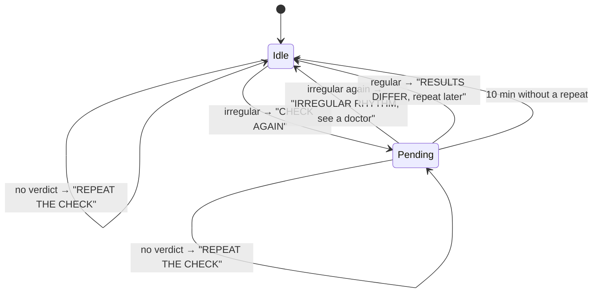

The rule comes from `ml/REPEAT_LTAFDB.md`: two irregular checks in a row cut false "irregular" on normal minutes from
13.2 % to 8.7 % at a cost of 1.3 points of AF found.

### 7.3 Alert and loan lifecycles

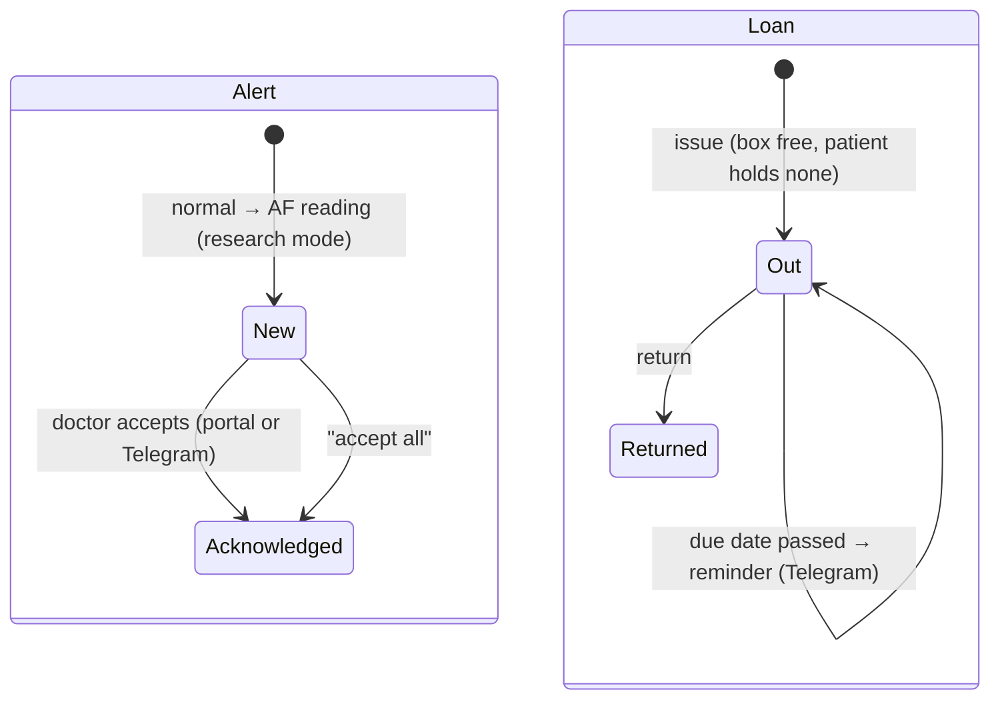

## 8. Deployment

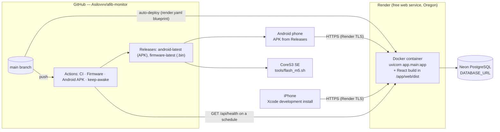

Configuration lives in environment variables only (`backend/.env.example` lists them without values). Health:
`/api/health` (no database access) and `/api/health?deep=1`. Operations, backup and rollback:
[EVALUATOR_GUIDE.md](EVALUATOR_GUIDE.md).

## 9. Technology selection

Criteria taken from the requirements: offline operation, one verdict on three tiers, cost (free tiers), one person
maintaining everything, regulatory wording control, reproducibility for the committee.

| Concern | Choice | Alternatives considered | Why this one, for this project | Price paid |
|---|---|---|---|---|
| On-device ML runtime | TensorFlow Lite Micro, int8 (ESP-NN kernels) | Edge Impulse, microTVM, hand-written C | the training notebooks export int8 directly; supported on ESP32-S3; 9.9 KB arena | a kernel bug on the chip gave wrong outputs for AF-like inputs (A4); found only by known-input checks, fixed by rewriting the dilated convolutions (`tools/firmware/undilate_model.py`), decision time 6 → 73 ms |
| Microcontroller | ESP32-S3 (M5Stack CoreS3 SE for the prototype) | nRF52840, STM32 + BLE module | BLE + 240 MHz dual core + vector instructions + 512 KB SRAM; dev kit with screen and battery; same chip in the patch design (`hardware/patch_v1`) | higher power than nRF52 (A10 not measured yet) |
| ECG front-end | AD8232 single lead | ADS1292, MAX30003 | cheap, available locally, one lead is enough for RR-based screening | noise (A8: 16 dB < 18 dB bar); no medical isolation |
| Phone app | React Native with Expo (TypeScript) | Kotlin + Swift, Flutter | one code base for Android and iOS, same language as the portal, the 30-s rule shared as TypeScript; BLE through a development build | Expo build tools carry dependency advisories (TEST_REPORT §5); iPhone installs expire every 7 days without a paid developer account |
| Portal | React 19 + Vite + TypeScript, served by the API container | server-rendered templates | live alerts (SSE), ECG on a grid, Poincaré plots; one container to deploy | client-side token storage (SECURITY_PRIVACY F-03) |
| Server | FastAPI (Python 3.12) | Django, Node/Express | the ECG analysis is the same Python as the research notebooks; Pydantic validation and OpenAPI docs come free; async SSE | one process: CPU-bound requests share one interpreter (NFR-12) |
| Database | PostgreSQL (Neon) in production and PostgreSQL 16 in CI, SQLite for local runs | MongoDB, MySQL | relational data with foreign keys and unique rules; window functions for monitored time; SQLite needs no setup for an evaluator | SQLite locks under many concurrent writers (NFR-12 run 1); no migration tool yet (§10.4) |
| Interface style | REST/JSON + Server-Sent Events | WebSocket, GraphQL | the only push is server → doctor; SSE works through Render's proxy and reconnects by itself | the browser's EventSource cannot send headers, so the token goes in the URL (F-05) |
| Authentication | bearer JWT (HS256, 30 days) | cookie sessions, OAuth provider | one mechanism for the app and the portal; no CSRF surface without cookies | no server-side revocation (F-04) |
| Hosting | Render free web service from `render.yaml` + Neon free PostgreSQL | Fly.io, Railway, a VPS | free, Docker, auto-deploy from `main`, managed TLS | sleeps after 15 min idle; 0.1 CPU; region Oregon (privacy note) |
| Messaging | Telegram Bot API | SMS gateway, WhatsApp Business API | free, no business verification, images and buttons in messages | depends on a third-party service the patient must use |
| Store billing | RevenueCat webhooks; clinics by invoice | own receipt validation | no card data reaches us | disabled until store keys exist |
| CI/CD | GitHub Actions | GitLab CI, Jenkins | free for a public repository; builds firmware and APK | scheduled jobs run late (TEST_REPORT §8) |

## 10. Data design

### 10.1 Entity–relationship diagram (`backend/app/models.py`, 28 tables)

```mermaid
erDiagram
  users ||--o{ users : "doctor_id (patient → doctor)"
  users ||--o{ readings : patient_id
  users ||--o{ alerts : patient_id
  alerts ||--o{ alert_acks : alert_id
  alerts ||--o{ telegram_messages : alert_id
  users ||--o{ ecg_strips : patient_id
  ecg_strips ||--o| strip_seen : "ecg_id (unique)"
  users ||--o{ symptoms : patient_id
  users ||--o{ notes : "patient_id, author_id"
  users ||--o{ episode_reviews : "patient_id, reviewer_id"
  users ||--o| risk_profiles : "patient_id (PK)"
  users ||--o{ consents : user_id
  users ||--o{ access_log : "patient_id, actor_id"
  users ||--o{ export_tokens : user_id
  users |o--o{ feedback : user_id
  users ||--o{ day_tags : "patient_id + day unique"
  users ||--o{ medications : patient_id
  medications ||--o{ med_doses : "medication_id + slot unique"
  users ||--o| check_plans : "patient_id (unique)"
  users ||--o{ vitals : patient_id
  users ||--o{ family_invites : patient_id
  users ||--o{ family_links : "patient_id, watcher_id"
  users ||--o{ devices : "owner_id + chip_id unique"
  devices ||--o{ device_issues : device_id
  users ||--o{ device_issues : "patient_id, doctor_id"
  users ||--o{ telegram_links : user_id
  users ||--o{ telegram_codes : user_id
  users ||--o{ plan_requests : user_id
  users |o--o{ billing_events : "user_id; event_id unique"
  users {
    int id PK
    string email UK
    string role "patient | doctor | family"
    string password_hash "bcrypt"
    string invite_code UK "doctors"
    int doctor_id FK "patients"
    string plan "free | family | doctor_free | clinic50 | clinic200"
  }
  readings {
    int id PK
    int patient_id FK
    datetime ts "UTC, index (patient_id, ts)"
    int state "0 collecting, 1 normal, 2 AF-like, 3 no signal"
    float prob
    float bpm
  }
  ecg_strips {
    int id PK
    int patient_id FK
    datetime ts
    int fs "125"
    text samples "JSON list"
    string reason "afib_onset | manual | symptom | check"
  }
  consents {
    int id PK
    int user_id FK
    string kind "terms | data | research"
    string version "text version, e.g. 2026-10b"
    datetime withdrawn_at
  }
```

Columns of every table are in `backend/app/models.py`; the diagram shows the keys and the four tables the rules depend on.

### 10.2 Integrity rules

| Rule | Where enforced |
|---|---|
| Foreign keys are checked on both databases | PostgreSQL natively; SQLite with `PRAGMA foreign_keys=ON` (`db.py`), so tests catch ordering bugs (regression 0801d2e) |
| One account per e-mail; one invite code per doctor | unique columns `users.email`, `users.invite_code` |
| One diary row per patient per local day; one answer per dose slot | unique indexes `ux_day_tags_patient_day`, `ux_med_doses_med_slot` |
| One "seen" per strip; one check plan per patient | unique `strip_seen.ecg_id`, `check_plans.patient_id` |
| One device per chip per clinic; a device is out to at most one patient; a patient holds at most one | unique `ix_device_owner_chip`; open-loan checks in `issue_device()` |
| Store webhook events processed once | unique `billing_events.event_id` |
| Physiological plausibility (BP 60–260/30–160, glucose 1–40, weight 20–300, HR ≤ 300, ECG ≤ 60 s) | Pydantic schemas in `main.py` → HTTP 422 |
| A doctor reaches only own patients | `own_patient()` → 404 (does not reveal that the id exists) |
| A schedule change keeps past adherence | `edit_med()` stores a new medicine row from now on |
| Deleting an account removes every row about the user, in reference order | `delete_me()`; tested on SQLite and PostgreSQL |

### 10.3 Indexes

Every foreign key used for lookups is indexed (`index=True` in `models.py`); time series have composite or time indexes:
`ix_readings_patient_ts (patient_id, ts)` for reports, `readings.ts`, `alerts.ts`, `ecg_strips.ts`, `symptoms.ts`,
`vitals.ts`, `access_log.ts`, `device_issues.due_at` (return reminders). Monitored time is summed inside the database with a
`LEAD()` window over `(patient_id, ts)` (`monitored_seconds_sql()`), which replaced a Python loop that froze the free server
(fix 00f6620).

### 10.4 Schema creation and migrations

`Base.metadata.create_all()` creates missing tables at start-up; `_add_missing_columns()` adds new nullable columns with
idempotent `ALTER TABLE` statements on SQLite and PostgreSQL. This is enough while every change is additive. **Limitation:**
there is no versioned migration tool (Alembic); a renamed or retyped column would need one. Initial data: `SEED_DEMO=1` runs
`backend/app/seed.py` (demo doctor and five demo patients, idempotent).

## 11. Interfaces

### 11.1 REST API

Machine-readable documentation: OpenAPI at `/docs` and `/openapi.json` (generated by FastAPI from the code; the one-time
export download link is deliberately left out of the schema).

**Conventions.** JSON over HTTPS; `Authorization: Bearer <JWT>` except the public endpoints (register, login, doctor-code
lookup, config, health) and the three secret-authenticated ones (Telegram webhook: `X-Telegram-Bot-Api-Secret-Token`;
RevenueCat webhook: `Authorization` shared secret; admin: `X-Admin-Token`; the admin and RevenueCat secrets are compared
in constant time, the Telegram one with a plain comparison — SECURITY_PRIVACY F-09). Times are UTC ISO
8601 with `Z`; uploads use Unix seconds.

| Status | Meaning in this API |
|---|---|
| 400 | request understood but not allowed (demo code for a real address, wrong plan for the role, not an export file) |
| 401 | no token, bad token, wrong password |
| 402 | `{"code": "plan_required", "feature": …}` — the feature belongs to a paid plan; the apps show what is included |
| 403 | wrong role, missing webhook or admin secret, wrong password on account deletion |
| 404 | not found **or not yours** (another doctor's patient, another patient's strip) |
| 409 | conflict: e-mail exists, doctor's cabinet full, device already out, import into a non-empty account |
| 413 | import file over 60 MB |
| 422 | validation error from the schema (FastAPI's `detail` list names the field) |
| 429 | 10 wrong passwords per account (50 per address) in 15 minutes |

| Group | Routes | Who | Examples |
|---|---|---|---|
| Auth and profile | 7 | everyone | `POST /api/auth/register`, `POST /api/auth/login`, `GET/PUT /api/me`, `PUT /api/me/doctor`, `GET /api/doctor-code/{code}` |
| Family | 6 | patient, family | `POST /api/me/family/invite`, `POST /api/family/link`, `GET /api/family/patients` |
| Readings, ECG, checks | 7 | patient, doctor | `POST /api/readings` (≤ 5,000 per call), `POST /api/ecg`, `GET /api/ecg/{id}`, `GET /api/checks/queue`, `POST /api/ecg/{id}/seen` |
| Diary, vitals, medicines, check plan | 14 | patient (doctor sets plans) | `POST /api/symptoms`, `POST /api/me/vitals`, `POST /api/me/day`, `POST /api/me/meds/{id}/dose`, `PUT /api/patients/{id}/checkplan` |
| Doctor views | 9 | doctor | `GET /api/patients`, `GET /api/overview`, `GET /api/patients/{id}/report`, alerts, notes, episode review |
| Privacy | 8 | everyone | consents, access log, export link and file, import, `DELETE /api/me` |
| Clinic rental | 9 | doctor (patient sees own loan) | `POST /api/devices/{id}/issue`, `POST /api/issues/{id}/return`, `GET /api/issues.csv` |
| Plans and billing | 5 | doctor, owner, RevenueCat | `POST /api/me/plan/request`, `POST /api/admin/plan`, `POST /api/billing/revenuecat` |
| Risk score | 3 | doctor, patient | `GET/PUT /api/patients/{id}/risk`, `GET /api/me/risk` |
| Telegram | 4 | everyone, Telegram | `POST /api/telegram/link`, `POST /api/telegram/webhook` |
| Live events, config, feedback, metrics, health | 5 | doctor / public | `GET /api/stream?token=` (events `alert`, `alert_ack`, `reading`, `symptom`, `ecg`, `telegram`), `GET /api/health` |

### 11.2 BLE protocol (`mobile/src/protocol.ts`, firmware `bleSend`)

Service `8f1e0001-4b6a-4c5e-9a0b-3a1f2e7d0001`, device name `AFib-Monitor`, little-endian:

| Characteristic | Size | Rate | Layout |
|---|---|---|---|
| STATUS `…0002` | 13 B | ~1/s and on every decision | `u8 version=1 · u8 state · u16 prob×1000 · u16 bpm×10 · u32 t_ms · u16 infer_us · u8 battery %` |
| ECG `…0003` | 46 B | 6.25/s (20 samples at 125 Hz) | `u16 seq · f32 scale · 20 × i16` (mV = i16 × scale) |

Known defect: `infer_us` is 16-bit and saturates at 65.5 ms since the model rewrite (true value 72.9 ms) — TEST_REPORT D-13.

### 11.3 Other interfaces

* **SSE** `GET /api/stream?token=` — doctors only; `hello` on connect, `: ping` every 15 s; queue of 500 events per
  connection, overflow dropped. The portal reconnects 5 s after an error and also re-reads its patient list every 30 s,
  so a dropped event is caught up.
* **USB serial** (115,200 baud) — bench and research: database playback, `--model-check`, `--bench`, 30-s check logs
  (`firmware/afib_stream.py`).
* **Telegram** — webhook in production, long polling locally; one-time link codes valid 24 h.

## 12. User interface

**Patient app** (`mobile/src/screens/`): four tabs — Monitor, History, Diary, Profile — plus sheets (30-s check, symptom,
device, plan). A relative's account opens a separate home screen (`Family.tsx`) with checks done, verdict words, typed blood
pressure and medicines only.

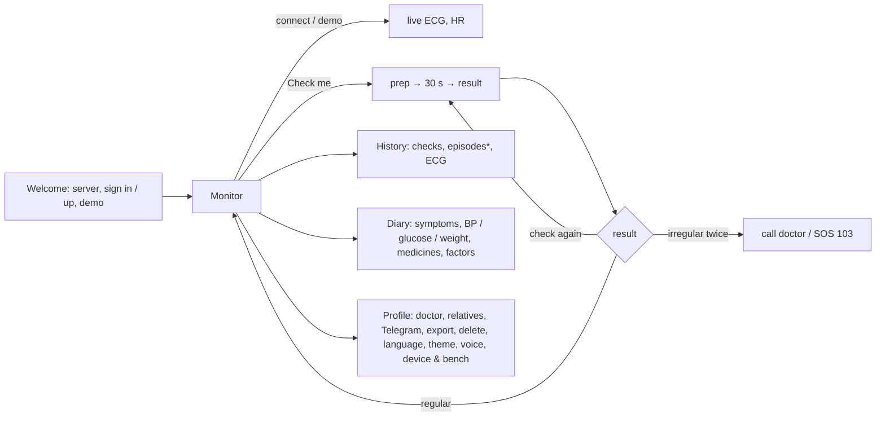
\* episodes and AF wording only in research mode.

**Doctor portal** (`web/src/pages/`): Overview (KPIs, irregular checks of the night, patients needing attention, AF burden),
Patients (search with `/`, filters), Patient (rhythm, episodes with review, ECG on 25 mm/s paper, Poincaré, symptoms, diary,
medicines, risk score, notes), printable Report, Alerts (live), Devices (rental), Settings (profile, invite code, Telegram).
Public pages: Landing, Join (invitation), Guide (printable patient guide with QR), Privacy, Terms.

**Feedback and states.** The server's error text (`detail`) reaches the user as a message or a toast (`ApiError` in
`web/src/api.ts`, `syncError` in the app); empty states have their own text (`no_check`, `no_episodes`, `no_symptoms`, `no_doctor` in the app; "Нет ЭКГ-записей за
период" in the portal); offline: the app shows the number of records waiting to be sent and keeps working; toasts confirm
saves. **Responsive:** below 860 px the portal's sidebar becomes a bottom bar and the grids collapse to one column; below
520 px the KPI tiles go two per row (`web/src/index.css`); phone-width screenshots are in `docs/screenshots/web/`.
**Accessibility:** results and known limitations in [SECURITY_PRIVACY.md §4](SECURITY_PRIVACY.md#4-accessibility).

## 13. Main design decisions

| # | Decision | Reason | Evidence |
|---|---|---|---|
| D1 | Inference on the device, not in the cloud | offline, privacy, free tier | §1 |
| D2 | One 30-s rule in three languages, guarded by shared strips | one verdict everywhere | CI parity 40/40 + 10/10 |
| D3 | Wellness by default; AF wording only for consenting pilot participants | unregistered device | `patient_mode()`, `docs/REGULATORY_BRIEF_RU.md` |
| D4 | Two irregular checks in a row before "see a doctor" | fewer false alarms at small sensitivity cost | `ml/REPEAT_LTAFDB.md` |
| D5 | Rewrite dilated convolutions instead of changing the model | TFLM kernel bug on the chip; weights unchanged, bit-exact | A4 → A4-повтор, CI `model` |
| D6 | Health check without database access; heavy sums inside the database and cached | free tier stability | fixes 4101531, 27ff7ac, 00f6620 |
| D7 | Relatives see words, never ECG or probabilities | privacy and anxiety | `test_family_mode_sees_plain_words_only` |
| D8 | Every pass rule committed before the data is read | honest evaluation | `ml/*PREREG*`, `docs/BOARD_DAY.md` |
